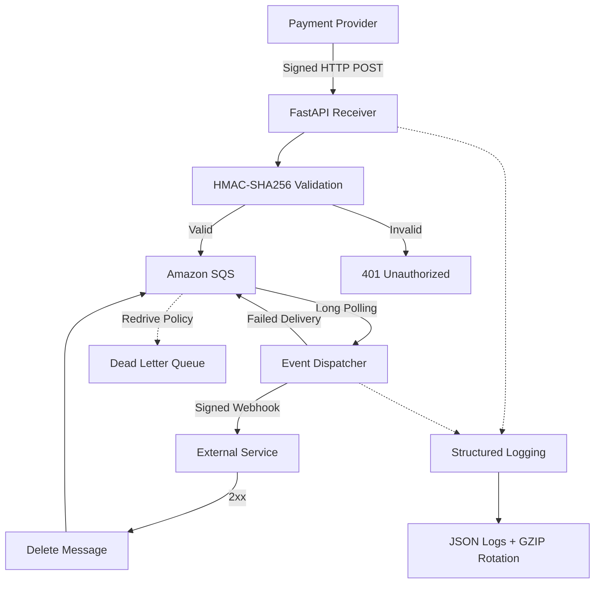

# Vulcano Pay

**Event processing engine built with Python, FastAPI, AWS SQS and HMAC-SHA256.**

Vulcano Pay is an event-driven system designed to receive payment webhooks, validate their authenticity, queue events and securely forward them to external services.

It uses **AWS SQS**, locally emulated with **LocalStack**, to decouple event reception from delivery.

## Architecture



### Event flow

1. **Receive:** FastAPI receives incoming webhooks.
2. **Validate:** HMAC-SHA256 signatures and timestamps are checked to prevent tampering and replay attacks.
3. **Queue:** Valid events are published to SQS.
4. **Dispatch:** The dispatcher consumes events using Long Polling and forwards them as signed webhooks.
5. **Retry:** Failed deliveries are retried. Messages are deleted only after successful delivery.
6. **Dead Letter Queue:** Messages that exceed the retry limit are automatically moved to the DLQ.

## Tech stack

| Technology | Purpose |
|---|---|
| Python 3.14 | Core application |
| FastAPI | HTTP webhook receiver |
| AWS SQS / LocalStack | Asynchronous event queue |
| Boto3 | SQS integration |
| HMAC-SHA256 | Webhook authentication |
| asyncio | Concurrent event processing |
| QueueHandler / QueueListener | Non-blocking logging |
| Pytest | Automated testing |
| Docker | LocalStack environment |

## Project structure

```text
src/
├── app_operator.py
└── vulcano_telemetry/
    ├── exceptions.py
    ├── sanitizer.py
    ├── core_sqs.py
    ├── webhook_crypto.py
    ├── webhook_receiver.py
    └── logging_engine.py

tests/
├── test_chaos.py
└── test_forensic_log.py

tools/
└── destino_demo.py
```

## Getting started

### 1. Clone and install

```bash
git clone https://github.com/DiegoCerrano/Vulcano_Pay.git
cd vulcano-pay

python -m venv .venv
source .venv/bin/activate

pip install -r requirements.txt
```

### 2. Start LocalStack

```bash
docker run --rm -p 4566:4566 localstack/localstack
```

### 3. Configure the webhook secret

```bash
export VULCANO_WEBHOOK_SECRET="your_secret_key_at_least_16_chars"
```

### 4. Start the receiver

```bash
python src/app_operator.py start-receiver
```

### 5. Start the destination demo

In another terminal:

```bash
python tools/destino_demo.py
```

### 6. Start the dispatcher

```bash
python src/app_operator.py start-dispatcher \
  --url http://localhost:9000/webhook
```

### 7. Publish an event

```bash
python src/app_operator.py produce-sqs \
  --topic payment.completed
```

## Testing

Run the complete test suite:

```bash
pytest -q
```

Run only integration tests (requires LocalStack):

```bash
pytest -q -m integration
```

The test suite covers signature validation, replay attacks, hostile CLI input, webhook delivery failures, retry behavior, SQS connectivity, poison messages, Dead Letter Queue handling and forensic log integrity.

## Engineering highlights

- **Security:** HMAC-SHA256 signatures, constant-time comparison and replay protection.
- **Reliability:** Retry policies, explicit message deletion and Dead Letter Queue handling.
- **Concurrency:** `asyncio.TaskGroup` with blocking I/O isolated through `asyncio.to_thread`.
- **Observability:** Structured JSON logs with UTC timestamps, exception-chain serialization and GZIP rotation.
- **Validation:** Dedicated CLI sanitizers and domain-specific exceptions.

---

*Developed as an academic software engineering project, following the requirements and evaluation criteria defined by the course.*